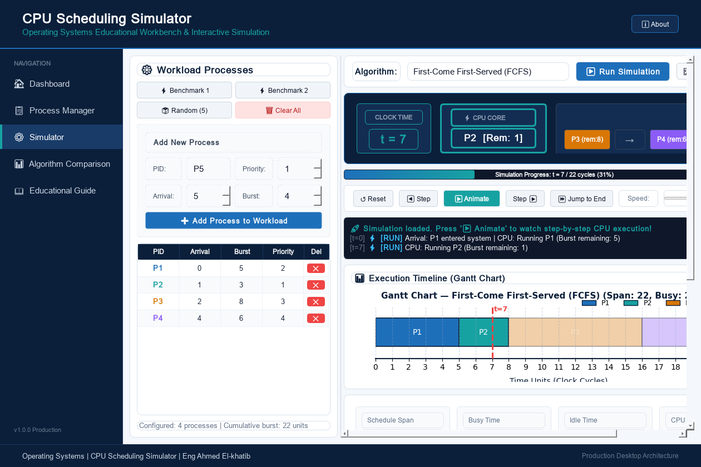
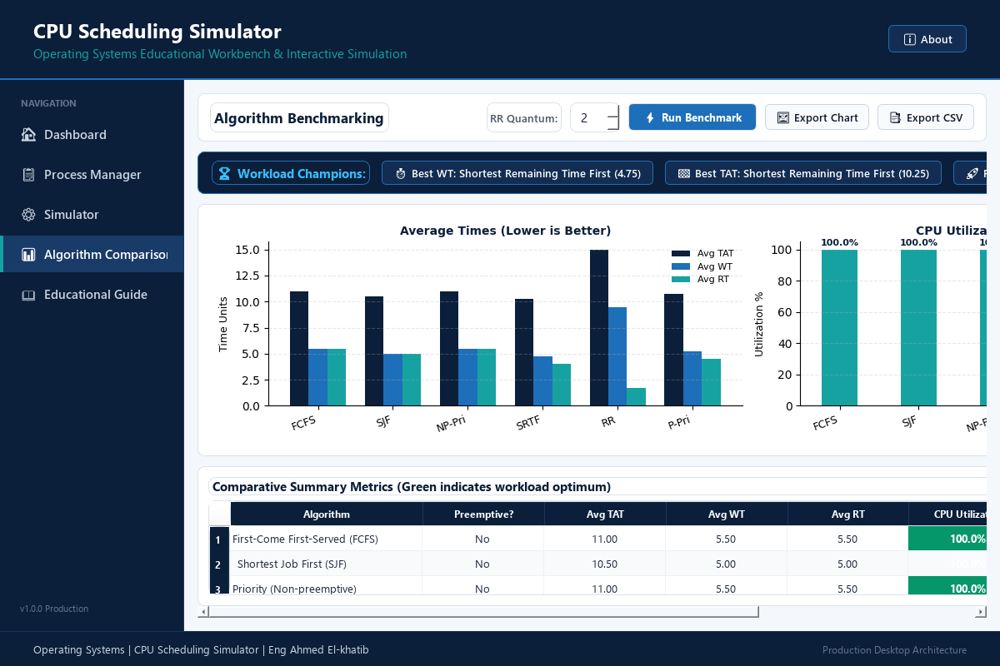
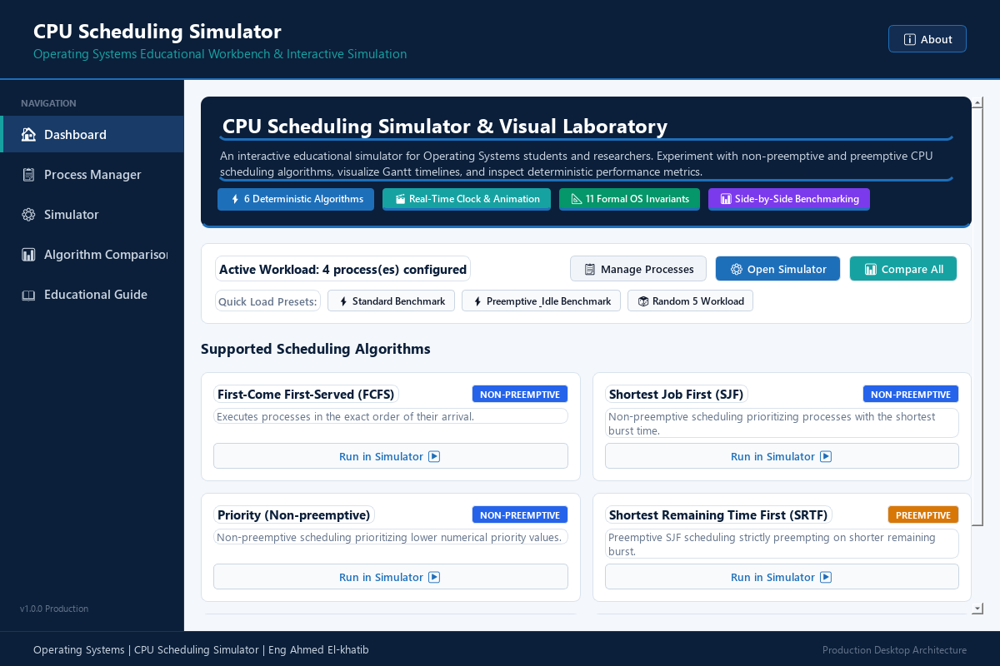
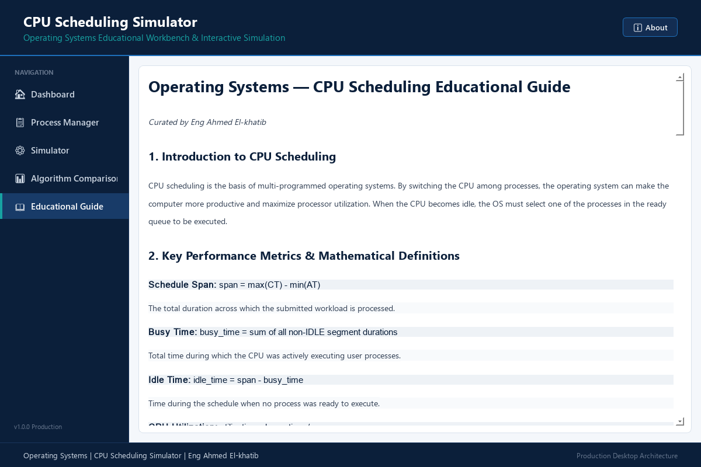
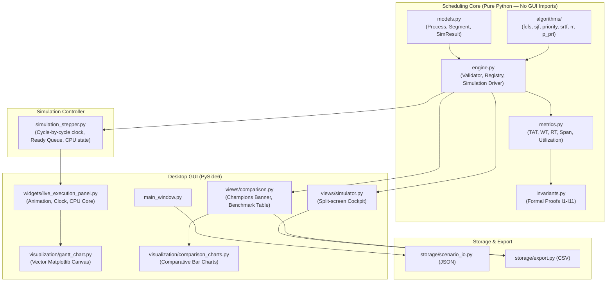

# CPU Scheduling Simulator & Visual Laboratory

[](https://www.python.org/)
[](https://wiki.qt.io/Qt_for_Python)
[](https://matplotlib.org/)
[-059669.svg)](https://docs.pytest.org/)
[](https://docs.astral.sh/ruff/)
[](https://mypy-lang.org/)
[](https://github.com/ahmed-el5hatib)
[](LICENSE)
[](https://github.com/ahmed-el5hatib/CPU-Scheduling-Simulator/releases/latest)

> **Author:** Eng Ahmed El-khatib  
> **Architecture:** Production-Quality Desktop Application (Python 3.11+ / PySide6 / Matplotlib)  
> **Verified Invariants:** 11 Formal Operating Systems Correctness Proofs (I1–I11)

---

## 📑 Table of Contents
1. [Overview & Visual Showcase](#-overview--visual-showcase)
2. [Key Innovations & Features](#-key-innovations--features)
3. [Interactive Gantt Charts & Execution Examples](#-interactive-gantt-charts--execution-examples)
4. [Supported Algorithms & Tie-Breaking Rules](#-supported-algorithms--tie-breaking-rules)
5. [System Architecture](#-system-architecture)
6. [Mathematical Metrics & Formal Invariants](#-mathematical-metrics--formal-invariants)
7. [Installation & Quick Start](#-installation--quick-start)
8. [Standalone Windows Executable](#-standalone-windows-executable)
9. [Verification & Test Suite](#-verification--test-suite)
10. [Directory Structure](#-directory-structure)
11. [Author & Credits](#-author--credits)

---

## 📸 Overview & Visual Showcase

The **CPU Scheduling Simulator & Visual Laboratory** is a comprehensive desktop educational and research workbench designed to simulate, inspect, analyze, and benchmark uniprocessor CPU scheduling algorithms. 

Built with strict separation of concerns, the simulator pairs a **100% deterministic pure Python discrete-time engine** with a modern **PySide6 desktop cockpit** and **interactive vector Matplotlib Gantt timelines**.

### 1. Live Simulator Cockpit & Animated Execution
The central cockpit features a split-screen workspace with real-time cycle clock, animated CPU core status with burst countdown, dynamic Ready Queue arrival pills, scrubbable timeline progress, and an active OS event console:



### 2. Multi-Algorithm Benchmarking & Workload Champions
Side-by-side comparison across all 6 algorithms evaluated against identical workloads, featuring dynamic "Workload Champions" highlight badges, comparative latency charts, and formatted summary tables:



### 3. Interactive Landing Dashboard
Quick-start hub with instant benchmark scenario loaders, feature badges, and direct algorithm launchers:



### 4. Educational Guide & Theoretical Tradeoff Matrix
In-app theoretical reference with mathematical formula proofs, OS glossary, and an algorithmic tradeoff matrix:



---

## ⚡ Key Innovations & Features

### 🎬 Real-Time Cycle Animation & Timeline Scrubber
- **Cycle-by-Cycle Clock ($t = X$):** Precise discrete-time tick counter.
- **CPU Core Execution Widget:** Shows currently running PID, active border color coding, and dynamic remaining burst countdown (`rem: X`). Changes to `IDLE 💤` when no process is ready.
- **Ready Queue Pills:** Live queue container rendering waiting tasks in strict arrival order (`[P3 (rem:8)] → [P4 (rem:6)]`).
- **Synchronized Red Scrubber:** Interactive red dashed cursor scrubbing across the Gantt timeline; past bars render at 100% opacity, while future slices remain dimmed at 35% opacity.
- **OS Event Terminal:** Color-coded auto-scrolling log capturing `Arrival`, `Context Switch`, and `Completion` milestones.
- **Playback Controls:** `↺ Reset`, `◀ Step Back`, `▶ Animate / ⏸ Pause`, `Step Forward ▶`, `⏩ Jump to End`, and a variable speed slider (150ms–1500ms).

### 🏆 Workload Champions & Benchmarking
- **Top Summary Banner:** Instantly highlights workload winners:
  - ⏱️ **Lowest Waiting Time (WT)**
  - 🏁 **Lowest Turnaround Time (TAT)**
  - 🚀 **Fastest Response Time (RT)**
  - ⚡ **Highest CPU Utilization (%)**
- **Optimal Cell Highlighting:** Optimum metrics in the comparison table are styled with emerald badges (`#059669`) with white bold text.
- **Dual Matplotlib Visualization:** Side-by-side charts for Latencies (TAT, WT, RT) and Processor Utilization with clean abbreviated labels.

### 💾 Data Persistence & Multi-Format Exports
- **Scenario Storage:** Save and load custom process workloads as standardized JSON scenarios.
- **Workload CSV Export:** Export input configurations (`PID`, `Arrival Time`, `Burst Time`, `Priority`).
- **Single Simulation CSV:** Export per-process timeline metrics and segment lists.
- **Comparative Benchmark CSV:** Export full 6-algorithm comparison tables for reports and papers.
- **High-Res Charts:** Export Gantt charts and comparison bar charts as vector SVG/PDF or high-DPI PNG.

---

## 📊 Interactive Gantt Charts & Execution Examples

Below are execution timelines generated from standard benchmark workloads:

### Example 1: Non-Preemptive FCFS Execution
*Workload:* $P_1 (AT=0, BT=5)$, $P_2 (AT=1, BT=3)$, $P_3 (AT=2, BT=8)$, $P_4 (AT=4, BT=6)$

```mermaid
gantt
    title First-Come First-Served (FCFS) Timeline
    dateFormat X
    axisFormat %s
    section Core Execution
    P1 :done, p1, 0, 5
    P2 :done, p2, 5, 8
    P3 :done, p3, 8, 16
    P4 :done, p4, 16, 22
```



### Example 2: Preemptive Round Robin ($q=2$) Execution
Demonstrating standard textbook arrival-before-preempt rule:

```mermaid
gantt
    title Round Robin (q=2) Timeline with Preemption
    dateFormat X
    axisFormat %s
    section Core Execution
    P1 (Slice 1) :done, rr1, 0, 2
    P2 (Slice 1) :done, rr2, 2, 4
    P1 (Slice 2) :done, rr3, 4, 6
    P3 (Slice 1) :done, rr4, 6, 8
    P2 (Finish)  :done, rr5, 8, 9
    P4 (Slice 1) :done, rr6, 9, 11
    P1 (Finish)  :done, rr7, 11, 12
    P3 (Slice 2) :done, rr8, 12, 14
    P4 (Slice 2) :done, rr9, 14, 16
    P3 (Slice 3) :done, rr10, 16, 18
    P4 (Finish)  :done, rr11, 18, 20
    P3 (Finish)  :done, rr12, 20, 22
```



---

## 📐 Supported Algorithms & Tie-Breaking Rules

All algorithms adhere to standard Operating Systems textbook conventions:

| Algorithm | Type | Selection Criterion | Tie-Breaking & Preemption Rules |
| :--- | :--- | :--- | :--- |
| **FCFS** | Non-preemptive | Earliest Arrival Time | Tie on arrival $\to$ Lower PID insertion index. |
| **SJF** | Non-preemptive | Shortest Burst Time | Tie on burst $\to$ Earlier arrival, then insertion order. Provably optimal in minimizing average waiting time. |
| **Priority** | Non-preemptive | Lowest Priority Value | Convention: **Smaller integer = Higher priority** ($1 > 2$). Tie $\to$ Earlier arrival, then insertion order. |
| **SRTF** | Preemptive | Shortest Remaining Time | Strict preemption: Preempts only if $new.rem < current.rem$. On equal remaining time, **do NOT preempt**. |
| **Round Robin** | Preemptive | FIFO Queue + Quantum $q$ | **Textbook Rule:** On quantum expiry AND new arrival at the exact same instant, newly arrived jobs enter the queue **BEFORE** the preempted process. |
| **Preemptive Priority** | Preemptive | Highest Priority ($1 > 2$) | Preempts if $new.priority < current.priority$. On equal priority, running process continues. |

---

## 🏗️ System Architecture

The project enforces Clean Architecture and Separation of Concerns:



---

## 🧮 Mathematical Metrics & Formal Invariants

### Performance Metrics Formulations

$$\text{Schedule Span} = \max(CT) - \min(AT)$$

$$\text{Busy Time} = \sum_{\text{non-IDLE}} \text{Duration}, \quad \text{Idle Time} = \text{Span} - \text{Busy Time}$$

$$\text{CPU Utilization} = \frac{\text{Busy Time}}{\text{Schedule Span}}, \quad \text{Throughput} = \frac{N_{\text{completed}}}{\text{Schedule Span}}$$

$$\text{Turnaround Time (TAT)} = CT_i - AT_i$$

$$\text{Waiting Time (WT)} = TAT_i - BT_i$$

$$\text{Response Time (RT)} = \text{First Start Time } (ST_i) - AT_i$$

$$\text{Average TAT} = \frac{1}{N} \sum_{i=1}^N TAT_i, \quad \text{Average WT} = \frac{1}{N} \sum_{i=1}^N WT_i, \quad \text{Average RT} = \frac{1}{N} \sum_{i=1}^N RT_i$$

### 11 Mathematically Verified Invariants (I1–I11)
Every execution run is tested against 11 formal Operating Systems invariants:
- **I1 — Non-negative Time Domain:** $0 \le AT_i \le ST_i \le CT_i$.
- **I2 — Sequential Core Execution:** Monotonic non-overlapping segments ($\forall k: \text{end}_k \le \text{start}_{k+1}$).
- **I3 — Non-preemptive Atomicity:** FCFS, SJF, and Priority execute each process in exactly one contiguous segment of duration $BT_i$.
- **I4 — Strict Arrival Precedence:** No process is dispatched before arrival ($ST_i \ge AT_i$).
- **I5 — Work Conservation:** $TAT_i = CT_i - AT_i = WT_i + BT_i$.
- **I6 — CPU Burst Energy Conservation:** $\sum \Delta t_i = BT_i$.
- **I7 — Span Partition Balance:** $\text{Span} = \text{Busy Time} + \text{Idle Time}$.
- **I8 — Bounded Utilization:** $0 \le \text{Utilization} \le 1.0$.
- **I9 — Zero Premature Dispatches:** CPU remains in `IDLE` when no processes are ready; no phantom execution.
- **I10 — Deterministic Tie-Breaking:** Identical arrival/burst states resolve predictably via arrival time and insertion order.
- **I11 — Ready Queue Consistency:** Discrete clock state faithfully models operating system ready-queue dispatching.

---

## 🚀 Installation & Quick Start

### Prerequisites
- Python 3.11+
- Windows 10/11, macOS, or Linux

### Option 1: Running from Source

```bash
# 1. Clone the repository
git clone https://github.com/ahmed-el5hatib/CPU-Scheduling-Simulator.git
cd CPU-Scheduling-Simulator

# 2. Create and activate a virtual environment
# Windows (PowerShell):
python -m venv .venv
.\.venv\Scripts\Activate.ps1

# Linux / macOS:
python3 -m venv .venv
source .venv/bin/activate

# 3. Install dependencies
pip install -r requirements.txt

# 4. Launch the application
python src/main.py
```

---

## 📦 Standalone Windows Executable

A standalone, zero-dependency Windows executable is available for direct execution (no Python installation required):

- 📥 **Direct Download:** [**Download CPUSchedulingSimulator.exe (v1.0.0)**](https://github.com/ahmed-el5hatib/CPU-Scheduling-Simulator/releases/download/v1.0.0/CPUSchedulingSimulator.exe)
- **Local Path:** [`dist/CPUSchedulingSimulator.exe`](dist/CPUSchedulingSimulator.exe)
- **Direct Run:** Double-click `CPUSchedulingSimulator.exe` or execute via terminal:
  ```powershell
  .\dist\CPUSchedulingSimulator.exe
  ```

To rebuild the executable locally from source:
```powershell
pyinstaller CPUSchedulingSimulator.spec --noconfirm
```


---

## 🧪 Verification & Test Suite

The simulator includes a rigorous testing suite covering edge cases, formal invariants, IO persistence, and GUI integration:

```powershell
# Run the complete test suite with coverage report
pytest -v --cov=scheduling --cov-report=term-missing

# Run Ruff linter
ruff check src tests

# Run strict Mypy type validation
mypy src
```

### Quality Gate Results:
- **Test Suite:** `79 passed in 11.26s` (100% pass rate)
- **Core Coverage:** `99% line coverage` across `src/scheduling/`
- **Mypy Static Typing:** `0 errors` across 37 source files
- **Ruff Linter:** `0 warnings`

---

## 📁 Directory Structure

```text
CPU-Scheduling-Simulator/
├── src/
│   ├── main.py                         # Application launcher & font initializer
│   ├── app/
│   │   ├── main_window.py              # Root window (Header, Sidebar, Workspace, Footer)
│   │   ├── navigation.py               # Sidebar navigation component
│   │   ├── about_dialog.py             # About dialog & credits
│   │   ├── views/
│   │   │   ├── dashboard.py            # Overview, feature badges, and preset loaders
│   │   │   ├── process_manager.py      # Process table, JSON import/export, workload tools
│   │   │   ├── simulator.py            # Split-screen Cockpit & Gantt visualization
│   │   │   ├── comparison.py           # Benchmarking view & Workload Champions banner
│   │   │   └── guide.py                # Theoretical guide, formulas & tradeoff matrix
│   │   └── widgets/
│   │       ├── live_execution_panel.py # Cycle clock, CPU core, Ready Queue, scrubber
│   │       ├── process_table.py        # Colorized PID process table
│   │       └── metrics_table.py        # Process metrics & summary statistics
│   ├── scheduling/
│   │   ├── models.py                   # Process, Segment, ProcessMetrics, SimResult
│   │   ├── engine.py                   # Pure scheduler driver & registry
│   │   ├── metrics.py                  # Standard OS metric definitions
│   │   ├── simulation_stepper.py       # Discrete clock state generator
│   │   ├── invariants.py               # Formal invariant verifiers (I1-I11)
│   │   └── algorithms/
│   │       ├── fcfs.py                 # First-Come First-Served
│   │       ├── sjf.py                  # Shortest Job First (Non-preemptive)
│   │       ├── priority.py             # Priority (Non-preemptive)
│   │       ├── srtf.py                 # Shortest Remaining Time First (Preemptive)
│   │       ├── round_robin.py          # Round Robin (Preemptive)
│   │       └── preemptive_priority.py  # Preemptive Priority
│   ├── visualization/
│   │   ├── gantt_chart.py              # Embedded Matplotlib Gantt chart
│   │   └── comparison_charts.py        # Comparative dual-panel bar charts
│   ├── storage/
│   │   ├── scenario_io.py              # JSON scenario save & load
│   │   └── export.py                   # CSV export for processes, runs, and comparisons
│   ├── styles/
│   │   ├── theme.py                    # Palette tokens and font configuration
│   │   └── app.qss                     # Production dark-navy & clean QSS stylesheet
│   └── resources/
│       └── version.py                  # Metadata & Author signature
├── tests/
│   ├── test_edge_cases.py              # Validation and edge-case tests
│   ├── test_fcfs.py                    # FCFS correctness tests
│   ├── test_gui.py                     # GUI lifecycle, offscreen rendering & screenshots
│   ├── test_invariants.py              # Parametric invariant verification (36 permutations)
│   ├── test_io.py                      # JSON & CSV round-trip tests
│   ├── test_metrics.py                 # Metric formula precision tests
│   ├── test_priority.py                # Priority tie-breaking tests
│   ├── test_round_robin.py             # Round Robin quantum & arrival tests
│   ├── test_sjf.py                     # SJF tests
│   └── test_srtf.py                    # SRTF preemption tests
├── screenshots/                        # High-resolution UI captures
├── CPUSchedulingSimulator.spec         # PyInstaller build specification
├── pyproject.toml                      # Tooling config (pytest, coverage, ruff, mypy)
├── requirements.txt                    # Pinned project dependencies
└── README.md                           # Documentation & user manual
```

---

## 👨‍💻 Author & Credits

Designed, developed, and verified by:

**Eng Ahmed El-khatib**  
Senior Desktop Engineer & OS Educator  
GitHub: [@ahmed-el5hatib](https://github.com/ahmed-el5hatib)

*Signature verified across all source files, GUI footers, About dialogs, and exported CSV data.*

---

## 📄 License

This project is licensed under the **MIT Open Educational License** — see the [LICENSE](LICENSE) file for details.
